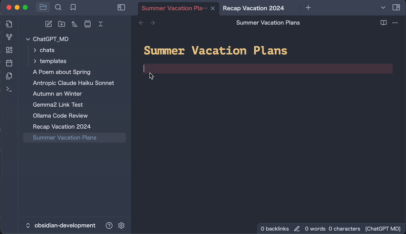

# ChatGPT MD

🚀 A seamless integration of ChatGPT, OpenRouter.ai and local LLMs via Ollama/LM Studio into Obsidian.



## 🚀 What's New

### v3.1.0: Agents System

**Create reusable AI personas with custom system prompts, models, and temperature settings.**

Define agents as Markdown files with frontmatter and a system prompt body. Apply an agent to any note with the `Choose Agent` command, or create new agents with the **AI Wizard**—describe what you want, and AI generates the name, temperature, and a comprehensive system prompt for you.

### v3.0.0: Privacy-First AI Tool Calling (off by default - Settings → ChatGPT MD → Tool Calling)

**Your AI assistant can now actively search your vault, read files, and query the web—with a human-in-the-loop architecture that keeps you in control.**

Tool calling built on privacy-first principles. When your AI needs information, it requests permission to use tools—you approve execution, review results, and control exactly what gets shared back to the model. Nothing leaves your vault without explicit consent.


## A simple and quick Start 🏁
Get started in just a few simple steps:

1. **Install ChatGPT MD**: Go to `Settings > Community Plugins > Browse`, search for `ChatGPT MD` and click `Install`.
2. **Configure OpenAI auth**: In plugin settings, choose either:
  - OpenAI API key (default), or
  - OpenAI OAuth bridge token (for OpenAI-compatible gateways that use your subscription auth upstream).

  You can also install Ollama/LM Studio and use local models.
3. **OAuth bridge automation (optional)**: If using OAuth bridge mode, fill in OAuth endpoints/client info and click `Connect` in settings. The plugin opens your browser and auto-captures callback on desktop localhost redirects.
4. **Start chatting**: Use the `ChatGPT MD: Chat` command (`cmd + p` or `ctrl + p`) to start a conversation from any note.

💡 *Pro tip*: Set up a hotkey for the best experience! Go to `Settings > Hotkeys`, search for `ChatGPT MD: Chat` and add your preferred keybinding (e.g., `cmd + j`).

Start chatting, don't worry too much about the more advanced features. They will come naturally :-) 

## Local LLM Setup (Ollama & LM Studio) 🏠

Want to keep your conversations private and avoid API costs? Use local LLMs with ChatGPT MD!

### Ollama Setup

1. **Install Ollama**: Download from [ollama.ai](https://ollama.ai) and install on your system
2. **Download a model**: Run in terminal:
   ```bash
   ollama pull llama3.2    # or any model of your choice
   ollama pull qwen2.5     # another popular option
   ```
3. **Configure ChatGPT MD**:
   - Go to `Settings > ChatGPT MD > Ollama Defaults`
   - The Ollama URL should already be set to `http://localhost:11434`
   - Set your default model in the settings (e.g., `ollama@llama3.2`)
4. **Start chatting**: Use the `ChatGPT MD: Chat` command to start conversations with your configured default model, or override it in individual notes:
   ```yaml
   ---
   model: ollama@llama3.2  # Override default if needed
   temperature: 0.7
   ---
   ```

### LM Studio Setup

1. **Install LM Studio**: Download from [lmstudio.ai](https://lmstudio.ai)
2. **Download and load a model** in LM Studio
3. **Start the server**: In LM Studio, go to Local Server and start it
4. **Configure ChatGPT MD**:
   - Go to `Settings > ChatGPT MD > LM Studio Defaults`
   - The LM Studio URL should be set to `http://localhost:1234`
   - Set your default model in the settings (e.g., `lmstudio@your-model-name`)
5. **Start chatting**: Use the `ChatGPT MD: Chat` command to start conversations with your configured default model, or override it in individual notes:
   ```yaml
   ---
   model: lmstudio@your-model-name  # Override default if needed
   temperature: 0.7
   ---
   ```

### Finding Your Model Names

- **Ollama**: Run `ollama list` in terminal to see installed models
- **LM Studio**: Check the model name in LM Studio's interface when the model is loaded

### Important Notes for Local LLMs

- **Default Model Configuration**: Set your preferred local model as the default in settings - it works just like cloud services
- **Per-Note Overrides**: You can override the default model in individual notes using frontmatter, same as with other providers
- **Model Discovery**: Use `ollama list` (Ollama) or check LM Studio interface to find your available model names for configuration

## Features
* **Interactive conversations**: 
  * Engage directly with ChatGPT, OpenRouter.ai models, and Ollama from any Markdown note, edit questions or responses on-the-fly, and continue the chat seamlessly.
* **Privacy & Zero API Costs:** 
  * Use local LLMs via Ollama, keeping your chats on your computer and avoiding API costs.
* **Web Access Models:**
  * Get real-time information from the web with OpenAI's `gpt-4o-search-preview` and Perplexity's `openrouter@perplexity/llama-3.1-sonar-small-128k-online` (via openrouter.ai).
* **Multiple AI Providers:**
  * Choose from OpenAI, OpenRouter.ai (with access to models like Gemini, Claude, DeepSeek, Llama, Perplexity), or local models via Ollama.
* **System Commands:** 
  * Instruct the LLM via system commands to get the best possible answers.
* **Link context**: 
  * Provide links to any other note in your vault for added context during conversations with Markdown or Wiki links.
* **Per-note Configuration:** 
  * Overwrite default settings via frontmatter for individual notes using params from [OpenAI API](https://platform.openai.com/docs/api-reference/chat), [OpenRouter.ai](https://openrouter.ai/docs), or [Ollama API](https://github.com/ollama/ollama/blob/main/docs/api.md#generate-a-chat-completion).
* **Markdown Support:** 
  * Enjoy full rendering of lists, code blocks, and more from all responses.
* **Minimal Setup:** 
  * Utilize your OpenAI API key, OpenAI OAuth bridge token, OpenRouter.ai API key, or install any LLM locally via Ollama.
* **Comment Blocks:** 
  * Ignore parts of your notes using comment blocks.
* **Chat Templates**: 
  * Use and share frontmatter templates for recurring scenarios. Explore [chatgpt-md-templates](https://github.com/bramses/chatgpt-md-templates).

## Privacy and Security

ChatGPT MD is 
- only storing data locally in your vault, with zero tracking and no 3rd party integrations except direct calls to the AI APIs (OpenAI, OpenRouter.ai).
- allowing you to use Ollama, a local LLM installation for offline conversation-based knowledge exploration.

### Default Configuration
The plugin comes with a well-balanced pre-configuration to get you started immediately. 
You can change the global settings or use the local parameters in any note via frontmatter
(start typing `---` in the first line of your note to add properties)
```
---
system_commands: ['You are a helpful assistant.']
temperature: 0.3
top_p: 1
max_tokens: 300
presence_penalty: 0.5
frequency_penalty: 0.5
stream: true
stop: null
n: 1
model: gpt-5-mini

# Service-specific URLs (optional, will use global settings if not specified)
openaiUrl: https://api.openai.com
# openrouterUrl: https://openrouter.ai
# ollamaUrl: http://localhost:11434
---
```
💡 Pro tip: Increasing `max_tokens` to a higher value e.g. `4096` for more complex tasks like reasoning, coding or text creation.
The default model `gpt-5-mini` is optimized for speed and efficiency. Upgrade to `gpt-5` for enhanced reasoning capabilities or use `gpt-5-nano` for ultra-lightweight responses.

### Tools

1. **Install**: Update or install v3.0.0+ from Obsidian
2. **Configure**: Settings → ChatGPT MD → Tool Calling → Enable,
3. **Optional**: Add [Brave Search API key](https://brave.com/search/api/) (free tier: 1,000 queries/month)
4. **Chat**: Use the `ChatGPT MD: Chat` command. AI will request tool use when needed.

The implementation follows a three-layer approval pattern:

1. **Execution Layer**: AI requests tool use with parameters
2. **Processing Layer**: Tool executes locally in your vault using Obsidian's API (full-text search across filenames and content)
3. **Approval Layer**: Interactive modals let you filter results before they're returned to the AI

### Available Tools

**Vault Search** (`vault_search`)
- Multi-word OR search: matches ANY query term across your vault
- Searches both filenames and file content simultaneously
- Excludes current file to prevent recursion
- Configurable result limits (default: 5 files)
- Query editing: refine search terms before execution

**File Read** (`file_read`)
- Direct file access when AI knows specific file paths
- Batch reading support for multiple files
- Full content extraction with your approval
- Useful for targeted lookups once files are discovered

**Web Search** (`web_search`)
- Powered by Brave Search API (privacy-focused, 1,000 free queries/month)
- Custom search provider support for self-hosted endpoints
- Optional full-page content fetching
- Automatic API key validation—tool only appears when configured
- Query editing: modify web search queries before execution

### Privacy & Security

- **Local-First Execution**: All vault operations run entirely within Obsidian's API
- **Selective Sharing**: Multi-select modals let you choose exactly which results to share
- **No Telemetry**: Zero tracking or analytics—tool usage stays private

### Configuration

Enable tool calling in **Settings → ChatGPT MD → Tool Calling**:

- **Enable Tool Calling**: Master switch (default: disabled)
- **Brave Search API Key**: Your Brave Search API key
- **Custom Provider URL**: Self-hosted search endpoint
- **Max Web Results**: Number of web results to return (1-10)

### Use Cases

**Research Assistant**: "Search my vault for notes about quantum computing algorithms and recent papers on the topic"

→ AI discovers relevant notes → You approve which files to share → AI synthesizes information with proper attribution

**Knowledge Synthesis**: "Find all my Q3 meeting notes and summarize key decisions about product roadmap"

→ Vault search returns meeting files → You select the relevant ones → AI extracts and summarizes decisions

**Web-Enhanced Writing**: "Search the web for latest climate change statistics and incorporate them into my article"

→ Web search fetches current data → You filter reliable sources → AI integrates citations into your draft

**Cross-Reference Discovery**: "Find notes that mention both machine learning and productivity techniques"

→ Multi-word OR search finds intersections → You approve interesting connections → AI highlights patterns you might have missed

⚠️ **Note**: Tool support depends on model capabilities. Older models may not support function calling. You can check tool capabilities in the tool selection list after enabling tool support in the settings.


### Multi Model Chats
You can set and change the model for each request in your note. 
Specify the `model` property via frontmatter:

for OpenAI models (including the latest GPT-5 family)
```
---
model: gpt-5  # or gpt-5-mini, gpt-5-nano, gpt-5-chat-latest
system_commands: [act as a senior javascript developer]
---
```
prefix it with `ollama@` for Ollama models or `lmstudio@` for LM Studio models.
```
---
model: ollama@gemma2:27b
temperature: 1
---
```


The AI responses will keep the used model name in the response title for future reference.
You can find the list of your installed Ollama model names from your terminal via `ollama list` or the available openAI model names online on this [openAI models](https://platform.openai.com/docs/models) page.

### Service URLs
Each AI service has its own dedicated URL parameter that can be configured globally in settings or per-note via frontmatter:

```
---
# For OpenAI
openaiUrl: https://api.openai.com

# For OpenRouter
openrouterUrl: https://openrouter.ai

# For Ollama
ollamaUrl: http://localhost:11434
---
```

The default URLs are:
- OpenAI: `https://api.openai.com`
- OpenRouter: `https://openrouter.ai`
- Ollama: `http://localhost:11434`

Note: Previous versions used a single `url` parameter which is now deprecated. Please update your templates and notes to use the service-specific URL parameters.

### OpenAI OAuth Bridge (Automated)

If your OpenAI-compatible gateway supports OAuth authorization code flow, ChatGPT MD can automate login and token exchange.

For the planned local `openai-codex` provider that uses Codex OAuth with supported ChatGPT plans instead of OpenAI API keys, see [docs/openai-oauth-roadmap.md](docs/openai-oauth-roadmap.md).

Development smoke test: run `yarn dev:codex-bridge`, set the OpenAI Codex URLs to `http://127.0.0.1:1455`, connect, verify health/models, then use `model: openai-codex@gpt-5.2-codex`.

1. Open `Settings -> ChatGPT MD -> API Keys`
2. Set `OpenAI Auth Mode` to `OAuth Bridge Token`
3. Configure:
  - `OpenAI OAuth Authorize URL`
  - `OpenAI OAuth Token URL`
  - `OpenAI OAuth Client ID`
  - `OpenAI OAuth Redirect URI` (default: `http://127.0.0.1:8765/callback`)
4. Click `Connect`
5. Complete login in browser
6. Return to Obsidian (token is stored automatically after callback)

If your environment cannot auto-capture callback, use `Exchange Callback URL` in the same settings section by pasting the full redirect URL.

Use `Verify OpenAI OAuth Token` to run a quick `/v1/models` health check.

### Subscription Bridge Modes (OpenAI Codex + Claude)

ChatGPT MD now supports explicit auth-mode toggles for two bridge-style flows where a local gateway can handle subscription/session auth upstream.

#### 1) OpenAI Codex Auth Mode

Path: `Settings -> ChatGPT MD -> API Keys -> OpenAI Codex Auth Mode`

- `Native/Session (Local Bridge)`:
  - Allows model discovery and requests without a local token when `OpenAI Codex URL` points to a local bridge (`openai-codex.local`, `localhost`, or `127.0.0.1`).
  - Intended for Paperclip-style local session/native auth handled by the bridge.
- `Token Only`:
  - Requires `OpenAI Codex Local Token`.
  - No tokenless fallback.

#### 2) Anthropic Auth Mode (Claude)

Path: `Settings -> ChatGPT MD -> API Keys -> Anthropic Auth Mode`

- `API Key (Default)`:
  - Standard Anthropic usage with `Anthropic API Key`.
  - Works with `https://api.anthropic.com` and compatible key-based endpoints.
- `Subscription (Bridge/Session)`:
  - Allows no-key flow only for local Claude-compatible bridge URLs (`claude.local`, `anthropic.local`, `localhost`, or `127.0.0.1`).
  - Non-local endpoints still require explicit credentials.

#### Important safety rule

Tokenless/keyless bridge mode is intentionally limited to local bridge hosts. This prevents accidentally sending unauthenticated requests to remote endpoints.

### Commands 👨‍💻
Run commands from Obsidian's command pallet via `cmd + p` or `ctrl + p` and start typing `chatgpt` or set hotkeys
(a chat command hotkey is highly recommended for effortless chats (I use `cmd + j`, which works fantastic, because your index finger is already resting on that key)).

#### Main Command
- **Chat**: Parse the file and interact with ChatGPT. Assign a hotkey, e.g. `cmd + j`.
  
#### Creation Commands
- **New Chat with Highlighted Text**: Start a chat using highlighted text and default frontmatter in `Chat Folder`.
- **New Chat From Template**: Create chats from templates in `Chat Template Folder`.

#### Utility Commands
- **Infer Title**: Automatically generate a note title based on the notes content. Configurable to auto-run after 4+ messages.
- **Add Comment Block**: Insert comment blocks for parts of your note that should be ignored.
- **Select Model**: Choose from all available LLMs (OpenAI, OpenRouter.ai, Ollama) and set the current model for your note.
- **Connect OpenAI OAuth Bridge**: Starts OAuth browser login flow and auto-captures callback when possible.

#### Maintenance Commands
- **Clear Chat**: Remove all messages while retaining frontmatter.
- **Stop Streaming (Desktop Only)**: Halt ongoing streams if necessary.

#### Formatting Tools
- **Add Divider**: Insert horizontal rulers to organize content visually.

## Beta Testing 🧪
Want to try the latest features before they're officially released? You can beta test ChatGPT MD using the [BRAT (Beta Reviewer's Auto-update Tool)](https://github.com/TfTHacker/obsidian42-brat) community plugin:

1. Install the BRAT plugin from Obsidian's Community Plugins
2. Open BRAT settings and add `bramses/chatgpt-md` as a beta plugin
3. Select "latest version" from the dropdown in the BRAT plugin settings
4. Enable the ChatGPT MD plugin in your community plugins list

This gives you early access to new features while they're still being developed and tested.

⚠️ **WARNING**: Beta testing is dangerous and happens at your own risk. Always test beta versions on a new empty vault, not on your main vault. Beta features can break and possibly lead to data loss.

## FAQs ❓
#### How do I start chatting with ChatGPT MD?
Use the `ChatGPT MD: Chat` command from the Obsidian command Palette (`cmd + p` or `ctrl + p`) to start a conversation from any note.

#### Can I set up a hotkey for the `ChatGPT MD: Chat` command?
Yes, you should! Go to `Settings > Hotkeys`, search for `ChatGPT MD: Chat` and add your preferred keybinding (e.g., `cmd + j`).

#### How do I use chat and reasoning models?
You can use OpenAI's GPT 3 and 4 models, various models through OpenRouter.ai (like Claude, Gemini, DeepSeek, Llama, Perplexity), or any model you have installed via Ollama.
DeepSeek-r1:7b works great for reasoning locally via Ollama.

#### How do I use a custom endpoint?
Ensure your custom API adheres to OpenAI's specifications, such as Azure's hosted endpoints. Consult your provider for API key management details.

#### Where should I add my OpenAI API key?
In the plugin settings, add your OpenAI API key and/or install Ollama and local LLMs of your choice.

#### Can I use OpenAI OAuth/subscription via a gateway?
Yes, if you have an OpenAI-compatible gateway that handles OAuth/subscription authentication upstream.

Configure:
- `Settings -> ChatGPT MD -> API Keys -> OpenAI Auth Mode = OAuth Bridge Token`
- Configure OAuth fields (`Authorize URL`, `Token URL`, `Client ID`, `Redirect URI`)
- Click `Connect` to automate browser login and callback exchange
- Optional fallback: paste callback URL into `Exchange Callback URL`
- `OpenAI URL` = your gateway base URL

Notes:
- The plugin still communicates using OpenAI-compatible HTTP APIs.
- Subscription/OAuth logic is handled by your gateway, not by this plugin directly.
- Refresh tokens are used automatically when available and near expiry.

#### What happened to the 'url' parameter in the frontmatter?
The single 'url' parameter is now deprecated. In v2.2.0 and higher, we've introduced service-specific URL parameters: `openaiUrl`, `openrouterUrl`, and `ollamaUrl`. This allows for more flexibility and clarity when configuring different services. Please update your templates and notes accordingly.

🤖 Enjoy exploring the power of ChatGPT MD in your Obsidian vault!🚀

## Contributions Welcome 🤝

Pull requests, bug reports, and all other forms of contribution are welcomed and highly encouraged! :octocat:

### Development Setup

```bash
# Clone the repository
git clone https://github.com/bramses/chatgpt-md.git
cd chatgpt-md

# Install dependencies
yarn install

# Development mode (watch for changes)
yarn dev

# Run tests
yarn test

# Run tests with coverage
yarn test:coverage

# Lint code
yarn lint
yarn lint:fix

# Production build
yarn build
```

### Testing

The project uses Jest for testing with 104 tests covering utility functions. Before submitting a PR:

1. Run `yarn test` to ensure all tests pass
2. Run `yarn lint` to check code quality
3. Run `yarn build` to verify the build succeeds

### Code Quality Standards

- **Complexity**: Functions should be under 50 lines with cyclomatic complexity ≤15
- **Type Safety**: Minimize `any` usage; prefer explicit types
- **Async Safety**: All promises must be handled properly (awaited, caught, or explicitly ignored)
- **Testing**: Add tests for new utility functions in `src/Utilities/*.test.ts`

### Pre-commit Hooks

Pre-commit hooks automatically run on `git commit`:
- ESLint auto-fixes linting issues
- Prettier formats code
- Only staged files are checked

### CI/CD

GitHub Actions automatically runs on pull requests:
- Lint check
- TypeScript type checking
- Test suite with coverage
- Production build

### Project Structure

```
src/
├── Commands/           # Obsidian command handlers
├── Services/           # Business logic & AI adapters
├── Views/              # UI components & modals
├── Utilities/          # Pure helper functions (well-tested)
├── Models/             # TypeScript interfaces
├── Types/              # Type definitions
└── core/               # Dependency injection container
```

For detailed development documentation, see [CLAUDE.md](CLAUDE.md) and [docs/development.md](docs/development.md).

### Submitting Changes

1. Fork the repository
2. Create a feature branch (`git checkout -b feature/amazing-feature`)
3. Make your changes (tests, linting, and docs)
4. Commit your changes (`git commit -m 'Add amazing feature'`)
5. Push to the branch (`git push origin feature/amazing-feature`)
6. Open a Pull Request

Your PR will be automatically checked by CI. Please ensure all checks pass before requesting review!

## About the Developers ✍️
Bram created ChatGPT MD in March 2023 lives in NYC and is building [Your Commonbase](https://bramses.notion.site/Your-Commonbase-ALPHA-10b034182ddd8038b9ffe11cc2833713) (A Self Organizing Scrapbook with Zero Stress Storing, Searching, and Sharing). His personal website and newsletter is located at [bramadams.dev](https://www.bramadams.dev/)

Deniz joined Bram in 2024 to continue development. He is working in a gaming company in Germany and uses AI heavily in his work and private life. Say "hi" on Bluesky: [Deniz](https://bsky.app/profile/denizokcu.bsky.social)

Happy writing with ChatGPT MD! 💻 🎉
